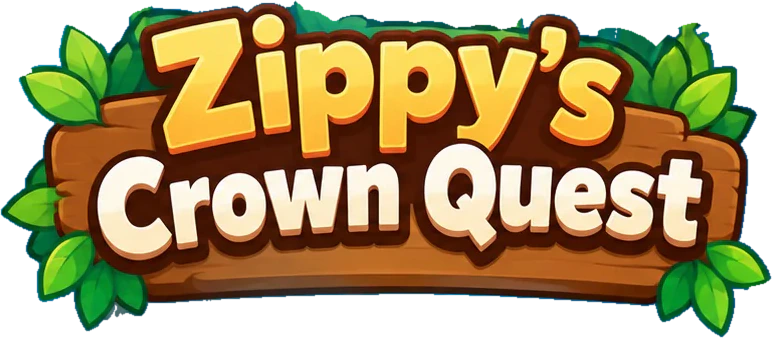

<div align="center">

# 👑 Zippy's Crown Quest

**Class 8 linear equations as a 25-minute voiced adventure on a balance scale.**

[](https://crown-quest-ten.vercel.app)





&nbsp;&nbsp;

&nbsp;&nbsp;


</div>

## About

Zippy's Crown Quest is a story-led browser game that teaches **linear equations in one
variable** to Class 8 learners (ages 12–14). Zippy the monkey has to swap crowns off a balance
scale for gold bars of the same mass. If the balance tips, an alarm wakes Grumble, the sleepy
monster who guards the treasure. Along the way the balance turns into an equation, and children
learn to check a value and then solve for x. A full play-through takes about 25–30 minutes.

## Highlights

- **Nine levels plus practice**, each building on the last: from a plain swap to x + 2 = 7,
  checking a value by substitution, solving x + 8 = 23 and 2x + 4 = 18
- **A balance that really weighs things.** Pans tip by the mass on them, so a wrong bar is
  visible straight away, and the equation is written in step with the balance
- **Fully voiced.** Every line has a recorded voice-over clip, and captions, equations, labels
  and highlights appear on the exact words they belong to, using per-word timings
- **Mistakes are safe and a little funny.** A wrong bar wakes Grumble, Zippy hands the crown
  back, and hints follow a miss
- **Learning activities** for the key words (variable, constant, equation, LHS, RHS, linear
  equation in one variable): a label activity, a sort activity and a quick recap
- **Practice round** of six equations answered by dragging number tiles. A wrong answer is
  worked through step by step on the board
- **Teacher-friendly.** A screens list and a replay button sit at the top left, chapter links
  like `index.html#L5` jump straight in, and Esc pauses the game
- **Runs anywhere.** Works offline from `index.html`, keeps a 16:9 stage on any screen, installs
  full screen on tablets, and supports reduced motion and a light mode for slow devices

## How to play

1. Press **Play** on the title screen and meet Zippy and Grumble.
2. Count the coins on each pan, then drag the gold bar that matches the crown to Zippy.
   He swaps it for the crown on his own.
3. From Level 4 the crown becomes **x**. Label the parts of an equation and sort linear from
   nonlinear equations.
4. In Levels 5–9, **check before you swap**: replace x with a value, work out the LHS and the
   RHS, and compare them.
5. Solve the six practice equations by dragging number tiles into `x = □`, then watch Zippy
   dance in the finale.

## Tech stack

- **HTML5, CSS3 and vanilla JavaScript** with no framework and no build step
- **Web Audio API** for sound effects and music; the browser's speech synthesis as a fallback
  for any line without a clip
- **Voice-over** as Ogg Opus clips plus AAC `.m4a` copies for Apple devices
- **WebP** images, with fonts embedded in `styles.css` so the game works offline
- **Web app manifest** for full-screen, landscape launch from a home screen
- **Asset tools:** Python 3 (Pillow, NumPy, SciPy), Swift (macOS), Node.js, FFmpeg and `cwebp`

## Run locally

```bash
git clone https://github.com/aniketchauhan-star/crown-quest.git
cd crown-quest
npx serve .
```

Then open the address it prints. You can also just double-click `index.html`, since the game
runs straight from the folder.

| Shortcut | What it does |
|---|---|
| `index.html#L5` | Start at a chapter: `intro`, `L1`–`L3`, `L4a`, `L4c`, `L4e`, `L4g`, `L5`–`L9`, `P`, `finale` |
| `?qa=1` | Show **Next** on every screen for testing |
| Esc | Pause, with Music, Sound effects, Voice and Reduced motion switches |

## Project structure

```
crown-quest/
├── index.html            # page shell and script order
├── styles.css            # all styling, with the fonts embedded
├── manifest.webmanifest  # full-screen, landscape install on phones and tablets
├── js/
│   ├── content.js        # every word, voice line, level number and answer (edit here)
│   ├── flow.js           # the story: intro, levels 1–9, practice, finale
│   ├── engine.js         # stage scaling, tweens, camera, dragging, pause, save
│   ├── world.js          # jungle layers, Zippy, Grumble, the balance, gold bars
│   ├── ui.js             # captions, hints, menu, screens list, the check panel
│   ├── activities.js     # formula screen, label and sort activities, recap, practice
│   ├── tiles.js          # draggable number tiles for practice answers
│   ├── audio.js / voice.js / vo_lines.js   # sound, voice playback and word timings
│   └── main.js           # loading and the animated title screen
├── assets/               # WebP art, sound effects (audio/) and voice clips (vo/)
├── docs/                 # voice-over guide, all game text, art briefs
└── tools/                # scripts that rebuild art, background, sounds and voice clips
```

All game text and numbers live in `js/content.js`, so they can be changed without touching the
game logic. For full design and build notes (screen-by-screen behaviour, editing the content,
remaking voice lines, replacing artwork), see [docs/DESIGN-NOTES.md](docs/DESIGN-NOTES.md) and
[docs/VOICEOVER.md](docs/VOICEOVER.md).

## Credits

- Design & development: **Aniket Chauhan**, UI/UX Designer & Developer
- Design review feedback: Karan
- Sound effects and the jungle ambience are cut from recordings, most of them Freesound CC0
  (public domain) clips; each source is listed in `tools/make_sounds.py`
- Fonts: Baloo 2 (SIL Open Font License) and Swifty Math for the x, based on Latin Modern Math
  (GUST Font License, see `assets/fonts/GUST-FONT-LICENSE.txt`)
